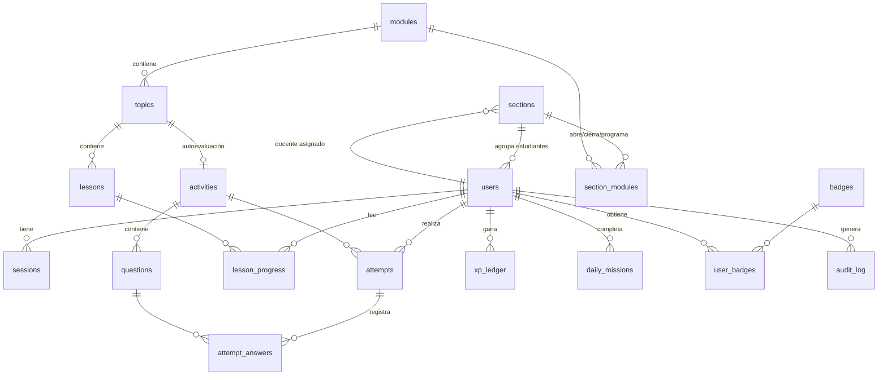

# GeoIstmo · Avance 3 · Análisis de materiales y arquitectura

Versión 0.3 alfa · 25 de octubre de 2026

## 1. Materiales analizados

| Material | Qué se revisó | Hallazgos principales |
|---|---|---|
| **Calendario de avances** (imagen) | Fila A3 y la estructura sugerida del informe | A3 · 28 de octubre · Fase 3 «Desarrollo y Programación (parte 1)». Entregable: **versión alfa: navegación completa, acceso de usuarios, motor de contenidos y primeras actividades**. Herramienta: **lenguaje de su elección**. A4 (11 nov) pide la beta completa con pruebas técnicas, de usabilidad y de accesibilidad; A5 (25 nov), la versión 1.0, manuales y capacitación. |
| **Documento del Avance 2 v1.1** (Word, completo) | Secciones 1 a 8: diseño instruccional, storyboard, mapa de navegación, guía de estilo, prototipo, validación, informe de avance y referencias | 3 roles con menús propios (estudiante 7 opciones, docente 5, administrador 8); 7 módulos; estructura de lección en 5 momentos; 8 tipos de actividad; rangos de calificación; gamificación (racha, XP, insignias, niveles, pasaporte, liga); paleta de 16 colores; tipografías Lora, Karla y Brawler; componentes y estados; ajustes de contraste; cambios de alcance C1 a C3; plan del siguiente periodo que asigna a A3 «estructura, navegación y acceso de usuarios». |
| **ZIP de SVG** (173 archivos, 170 MB) | Todos los archivos, descomprimidos y analizados uno por uno | 99 pantallas de 1440 × 900 px + 54 copias «después de la misión» (prefijo R-) + 20 rótulos de sección. Las pantallas son **maquetas completas**, no íconos sueltos: el texto está convertido en trazos y cada una incrusta imágenes PNG/JPEG en base64. Se extrajeron **14 imágenes únicas** (logotipo, panel de ingreso, mascota, insignia del Volcán Barú, diagrama de esclusas, 7 fotografías y un banner). Detalle en `RECURSOS.md`. |

## 2. Qué es obligatorio en el Avance 3 y qué no

La fuente de lo obligatorio es la fila A3 del calendario. El Avance 2 (sección 7.1, «Plan del siguiente periodo») coincide: *diseñar la base de datos, preparar el entorno y construir la estructura, la navegación y el registro e inicio de sesión (versión alfa)*.

| Obligatorio en A3 (calendario) | Cómo se interpretó |
|---|---|
| Navegación completa | Todas las rutas de los tres roles con menú propio, rutas protegidas y vuelta al ingreso del mismo rol (cambio C3). Las opciones de funciones de A4 se muestran como pendientes, sin enlace. |
| Acceso de usuarios | Registro, ingreso por rol, cierre de sesión, sesiones seguras y permisos en el servidor. |
| Motor de contenidos | Módulos → temas → lecciones → autoevaluación, almacenados en la base de datos y editables por el administrador, con bloqueo por docente y por secuencia. |
| Primeras actividades | Las tres de la **misión del día** (Avance 2, 3.2): relacionar conceptos, ubicar la capital y verdadero o falso, más las autoevaluaciones de tema. |

**Se deja para A4 o A5** (detalle en `PENDIENTES.md`): mapa interactivo y reto «¿Qué lugar es?», apuesta y descubrimiento, tareas con archivo, calificación de entregas, noticias y debates, liga, pasaporte, avisos, escuelas, calendario, reportes, configuración, importación CSV, pruebas de usabilidad y accesibilidad formales, manuales.

## 3. Contradicciones y vacíos encontrados, con la decisión tomada

| N.º | Situación | Dónde | Decisión y motivo |
|---|---|---|---|
| X1 | Los requisitos RF-01 a RF-14 y RNF-01 a RNF-09 se **citan** en el Avance 2, pero su texto completo está en el Avance 1, que no se entregó para este trabajo. | A2, fichas 3.3 y tablas | Se usa el significado que les da el propio Avance 2 (p. ej., «RF-06 mapa interactivo», «RNF-01 máximo 3 clics»). La matriz lo indica en la columna «Fuente». No se inventan requisitos nuevos. |
| X2 | El calendario dice que la entrega final es «el lunes 30 de noviembre», pero A5 aparece el 25 de noviembre. | Calendario | No afecta al A3. Se recomienda confirmarlo con el profesor. |
| X3 | Hallazgo H1: «Mis notas» muestra 87, pero la fórmula Tareas 40 % · Quices 30 % · Participación 30 % da 87,6. | A2, 6.3 | En la alfa no existen tareas ni participación, así que **no se aplica la ponderación**: «Mis notas» muestra el promedio simple de las autoevaluaciones y lo **explica en pantalla**. La fórmula ponderada queda para A4. |
| X4 | La escala de notas (0–100 % o 1,0–5,0) y los rangos 90/80/60 no están confirmados. | A2, decisión D3 | Se usa 0–100 % con los rangos del Avance 2 (Dominado, Logrado, En proceso, Por reforzar). Están en una sola función (`server/services/progreso.js → banda`) para cambiarlos con facilidad. |
| X5 | Los niveles Explorador, Cartógrafo, Analista y Geógrafo tienen nombre pero no umbral de XP. | A2, 2.7 | Umbrales propuestos: 0, 200, 500 y 1000 XP. Marcados como propuesta en el código. |
| X6 | No hay docente experto designado: el contenido no está validado. | A2, R4 y D2 | Las lecciones y preguntas se limitan a conceptos generales y capitales provinciales, **sin estadísticas**. Los ejemplos numéricos de densidad se rotulan «ejemplo ilustrativo (no es un dato real)». Los datos del prototipo que requieren fuente (71,5 hab/km² de Chiriquí, ≈ 53 de promedio nacional) **no se usan**. |
| X7 | El prototipo tiene un conmutador «Ver como: Estudiante · Docente · Admin» en todas las pantallas. | Frames 01-04, 09-01, 10-04 | Es una ayuda para navegar el prototipo en Figma, no una función del producto. En la aplicación real, el rol lo fija la cuenta y el servidor. No se implementa. |
| X8 | En los SVG, los títulos se ven con una tipografía distinta de la que describe la guía (Lora); como el texto está convertido en trazos, no se puede saber cuál es. | Renders de los SVG frente a la sección 5.3 | Se sigue la **guía escrita** (Lora, Karla y Brawler), que el propio A2 marca como la referencia que falta confirmar en Figma. |
| X9 | Dos combinaciones de color no cumplen el contraste AA. | A2, 5.6 | Se aplican los ajustes propuestos: rojo de texto `#A13A28` sobre rojo suave y río oscurecido `#1F7A7A` en botones; el ámbar no se usa como color de texto. |
| X10 | Los nombres del equipo se escriben de dos formas distintas. | A2, tabla 1 frente a tabla 7.1 | Se documenta en el README para que el equipo los unifique. |
| X11 | Responsive: el OE5 y RNF-07 lo piden, pero el cambio C1 limita el diseño a escritorio. | A2, 7.3 | Diseño de referencia de 1440 × 900 y adaptación solo con CSS (comprobada en 1024 px y 390 px sin desplazamiento horizontal), como indica C1. |

## 4. Arquitectura

```
Navegador (HTML + CSS + JS módulos)        Servidor Node.js + Express                 SQLite (archivo local)
┌──────────────────────────────┐   JSON   ┌────────────────────────────────────┐    ┌──────────────────────┐
│ js/app.js   enrutador y menú │ ───────► │ middleware/seguridad  CSP, CSRF,    │    │ data/geoistmo.db     │
│ js/views/*  pantallas        │  cookie  │                       límite login  │    │ 17 tablas            │
│ js/api.js   cliente HTTP     │ ◄─────── │ middleware/auth       sesión y rol  │ ─► │ (schema.sql)         │
│ css/estilos.css  guía A2     │          │ routes/*              HTTP por rol  │    │                      │
└──────────────────────────────┘          │ services/*            lógica        │    └──────────────────────┘
                                          │ db/*                  acceso a datos│
                                          └────────────────────────────────────┘
```

**Separación por capas**, como pide el enunciado:

| Capa | Carpeta | Responsabilidad |
|---|---|---|
| Interfaz | `public/` | Solo muestra datos y envía acciones. No conoce las respuestas correctas ni decide permisos. |
| Rutas | `server/routes/` | Traducen HTTP a llamadas de servicio y validan los identificadores. |
| Autenticación y seguridad | `server/middleware/` | Sesión, rol requerido, CSRF, cabeceras y límite de intentos. |
| Lógica de negocio | `server/services/` | Motor de contenidos, corrección, XP, racha, insignias, docente y administrador. |
| Acceso a datos | `server/db/` | Esquema, conexión, transacciones y datos de demostración. |
| Componentes educativos | `server/db/seed-content.js` + `public/js/views/actividad.js` | Contenido y reproductor de actividades. |

### 4.1 Rutas de la interfaz

| Rol | Rutas |
|---|---|
| Público | `/ingreso`, `/ingreso/docente`, `/ingreso/admin`, `/registro` |
| Estudiante | `/estudiante`, `/estudiante/mision`, `/estudiante/modulos`, `/estudiante/modulos/:id`, `/estudiante/temas/:id`, `/estudiante/actividad/:id`, `/estudiante/notas`, `/estudiante/insignias` |
| Docente | `/docente`, `/docente/modulos`, `/docente/resultados` |
| Administrador | `/admin`, `/admin/usuarios`, `/admin/secciones`, `/admin/catalogo` |

### 4.2 API

Todas las rutas empiezan por `/api`. Cada grupo exige su rol **antes** de ejecutar la lógica (`server/app.js`).

| Grupo | Rutas principales |
|---|---|
| `/auth` (público) | `POST /registro`, `POST /login`, `POST /logout`, `GET /me` |
| `/estudiante` | `GET /inicio`, `GET /mision`, `GET /modulos`, `GET /modulos/:id`, `GET /temas/:id`, `POST /lecciones/:id/leida`, `POST /actividades/:id/intentos`, `POST /intentos/:id/respuestas`, `GET /notas`, `GET /perfil` |
| `/docente` | `GET /secciones`, `GET /secciones/:sid/panel`, `GET /secciones/:sid/modulos`, `PUT /secciones/:sid/modulos/:mid`, `GET /secciones/:sid/resultados` |
| `/admin` | `GET /resumen`; usuarios (`GET`, `POST`, `PATCH`, restablecer clave); secciones (`GET`, `POST`, `PATCH`); catálogo (`GET /catalogo`, `PATCH /modulos/:id`, `POST /modulos/:id/temas`, `PATCH`/`DELETE /temas/:id`, `PATCH /actividades/:id`, CRUD de `/actividades/:id/preguntas`) |

## 5. Modelo de datos



| Tabla | Para qué sirve |
|---|---|
| `users` | Cuentas con rol (`estudiante`, `docente`, `administrador`), estado activo y sección del estudiante. Contraseña solo como hash bcrypt. |
| `sections` | Secciones (12.º A, 12.º B), su código de registro y el docente asignado. |
| `sessions` | Sesiones abiertas. Se guarda el **SHA-256** del token, no el token. |
| `modules`, `topics`, `lessons` | Motor de contenidos. Las lecciones guardan bloques (párrafo, lista, destacado, imagen). |
| `activities`, `questions` | Actividades de la misión (posición 1 a 3) y autoevaluaciones de tema. `answer_json` solo lo lee el servidor. |
| `section_modules` | Estado de cada módulo por sección: abierto, cerrado o programado con fecha. |
| `lesson_progress` | Lecciones leídas por cada estudiante. |
| `attempts`, `attempt_answers` | Cada intento y cada respuesta, con vidas, combo, puntaje y porcentaje final. |
| `xp_ledger` | Libro de XP con referencia única para **no pagar dos veces** el mismo logro. |
| `daily_missions`, `badges`, `user_badges` | Misión del día completada, insignias del álbum (8) y las ganadas por cada estudiante. Permiten calcular la racha. |
| `audit_log` | Registro de acciones de docentes y administradores (aparece en el resumen del administrador). |

### 5.1 Reglas del motor de contenidos

1. Un **módulo** está abierto para un estudiante si su sección lo tiene `abierto`, o `programado` con la fecha ya cumplida.
2. Un **tema** está completado cuando el estudiante leyó todas sus lecciones **y** obtuvo **≥ 80 %** en la autoevaluación (meta del Avance 1).
3. Un tema solo se abre si el anterior está completado. Si un tema no tiene lecciones, aparece «En preparación».
4. La autoevaluación se abre al leer todas las lecciones. **Cuenta el mejor intento.**
5. Cada actividad tiene 3 vidas; al perderlas, el intento termina sin XP.
6. La misión del día se completa con los 3 retos; da +15 XP de bono, suma un día de racha y desbloquea la siguiente insignia del álbum. Repetir un reto no vuelve a pagar XP.

## 6. Seguridad aplicada

| Riesgo | Medida |
|---|---|
| Contraseñas expuestas | bcrypt con costo 12; nunca se guardan ni se devuelven en texto plano. Las respuestas de la API no incluyen el hash. |
| Robo de sesión | Token aleatorio de 256 bits en cookie `HttpOnly` y `SameSite=Lax` (`Secure` opcional con HTTPS); en la base solo su SHA-256; caducidad de 8 h (14 días con «mantener sesión»). |
| Acceso indebido por URL | `requerirRol()` en cada grupo de la API; además, el docente solo accede a **sus** secciones y el estudiante solo a **sus** intentos. |
| Inyección SQL | Todas las consultas usan sentencias preparadas con parámetros. |
| XSS | Todo texto dinámico pasa por `esc()` en la interfaz; política CSP que solo permite scripts propios (sin `eval` ni scripts en línea). |
| CSRF | Cabecera obligatoria `X-GeoIstmo` + verificación de `Origin` + cookie `SameSite=Lax`. |
| Fuerza bruta | 5 intentos fallidos por correo e IP bloquean 15 minutos. |
| Enumeración de cuentas | Mismo mensaje y tiempo de respuesta para correo inexistente, clave incorrecta, rol equivocado o cuenta suspendida. |
| Trampa en actividades | La respuesta correcta nunca llega al navegador antes de responder; cada pregunta se responde una sola vez por intento; el puntaje y el XP se calculan en el servidor. |
| Escalada de privilegios | El registro público solo crea estudiantes. Un administrador no puede quitarse su propio rol ni suspenderse. Al cambiar el rol o suspender una cuenta, se cierran sus sesiones. |
| Secretos en el código | No hay: el sistema no usa claves externas. `.env` está en `.gitignore`. |
